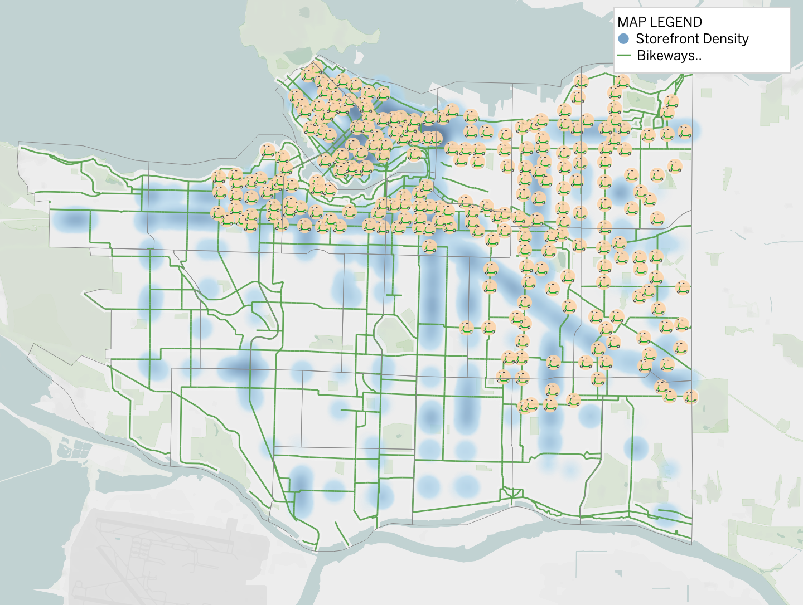

# Mobility and Business Access in Vancouver

**Tableau geospatial analysis · UBC Sauder MBAN · BAIT 518 Data Visualization · October 2026**

Where do Vancouver’s shopping streets have limited access to bikeways and shared e-scooter parking? This team project overlays storefronts, bikeways and Lime docking stations across the city’s 22 neighbourhoods. The dashboard helps city planners and business improvement associations identify commercial areas for a closer look.

[View the project report](report/final-report.pdf) · [Open the workbook download page](tableau/vancouver-mobility-business-access.twbx)



*Tableau map from the team’s final report. Blue shading shows storefront density, green lines show bikeways and orange markers show Lime stations in the project snapshot. Basemap © 2026 [Mapbox](https://www.mapbox.com/about/maps/) © [OpenStreetMap contributors](https://www.openstreetmap.org/copyright).*

## Key findings

- **Sunset stands out for gaps in both modes.** It ranks first in the dashboard’s storefront record count among neighbourhoods without Lime docks and is among the areas with the lowest storefront proximity to bikeways. The team proposed exploring dock sites near shopping blocks and short cycling connections to nearby routes.
- **Scooter parking is unevenly distributed.** Nine of 22 neighbourhoods had no Lime dock in the study snapshot. Marpole, Kerrisdale, West Point Grey and Arbutus Ridge all show commercial activity despite the gap. The team highlighted the Kerrisdale–Arbutus Ridge boundary as a candidate for further review.
- **The type of gap varies by area.** The report’s bikeway chart shows higher proximity in Downtown and the West End than in Sunset, Victoria-Fraserview and Shaughnessy. Along Kingsway, the team identified cycling connections to commercial blocks as a priority where scooter stations were already present.

## Data and method

| City of Vancouver source | Packaged snapshot |
| --- | --- |
| [Local area boundaries](https://opendata.vancouver.ca/explore/dataset/local-area-boundary/) | 22 neighbourhood polygons |
| [Storefronts inventory](https://opendata.vancouver.ca/explore/dataset/storefronts-inventory/) | 61,640 survey records across 2020–2026, representing 10,079 distinct storefront IDs before filtering |
| [Bikeways](https://opendata.vancouver.ca/explore/dataset/bikeways/) | 3,774 route segments |
| [Lime docking stations](https://www.arcgis.com/home/item.html?id=8c23648a641d4ac1b0ae742586ec2dce) | 250 stations with 3,059 parking spaces |

1. **Assign features to neighbourhoods.** Tableau spatial intersections link storefronts and station geometries to neighbourhood boundaries. The map layers storefront density, bikeways and docks.
2. **Estimate bikeway proximity.** A 100 m buffer around each storefront intersects the bikeway network. The metric divides distinct storefront IDs with an intersection by all distinct storefront IDs in that neighbourhood. The workbook excludes automotive businesses and vacant units from its storefront measures.
3. **Identify scooter coverage gaps.** The workbook flags neighbourhoods with zero or missing summed station capacity. The scooter chart compares counts of storefront survey records for those neighbourhoods, so a storefront can appear across multiple years.

Contains information licensed under the [Open Government Licence – Vancouver](https://opendata.vancouver.ca/pages/licence/).

## View the project

**In your browser.** Open the [PDF report](report/final-report.pdf) for the full analysis, charts and recommendations.

**Interactively in Tableau.**

1. Install Tableau Desktop 2026.3 or newer on Windows or macOS. The free Tableau Desktop Public Edition is an option for local viewing. [Tableau Desktop releases](https://www.tableau.com/support/releases) · [Tableau Public Edition download](https://www.tableau.com/products/public/download)
2. Open the [workbook file page](tableau/vancouver-mobility-business-access.twbx) on GitHub and use **Download raw file** to save the `.twbx` locally. In Tableau, choose **File → Open** and select the downloaded file. The package contains the data used by the workbook.
3. The story **Small Scale Transport in Vancouver** opens on **Citations**. Choose **Map View**, **No Scooters**, **No Bikelanes** or **Dashboard**. In **Dashboard**, click a bar to highlight a neighbourhood and focus the bikeway layer. Click a blank area of the chart to restore the citywide view.

## Limitations

- **Approximate distance.** Storefront coordinates are accurate to roughly a city block. The 100 m straight-line buffer measures proximity and does not account for route continuity, crossings or bikeway quality.
- **Coarse scooter coverage.** A dock just across a neighbourhood boundary can still serve nearby stores. Station locations and capacity reflect the packaged snapshot and may change.
- **Observational analysis.** The measures describe geographic access and cannot estimate trips, customer spending or the effect of adding infrastructure.
- **Different analysis scopes.** The report describes a 2026 storefront slice, while the saved workbook uses records across 2020–2026. The scooter chart counts survey records, and the bikeway chart uses distinct storefront IDs. The report also gives conflicting storefront totals for Sunset, so the summary uses its relative ranking.

## Repository structure

```text
README.md                                      Project overview and viewing guide
assets/vancouver-mobility-map.png                Map from the report
report/final-report.pdf                         Portfolio copy of the final team report
tableau/vancouver-mobility-business-access.twbx  Packaged Tableau workbook
```

## Team

Completed by **Group 1** for BAIT 518 Data Visualization in the UBC Sauder Master of Business Analytics program. **Tanner Brine, Yuheng Wu, Serena Li, Shivaang Jain, Silvia De Hoyos and Ioannis Polyzopoulos.** The report appendix credits the AI tools used during the project. The portfolio PDF preserves that disclosure and removes student IDs and conversation links.
